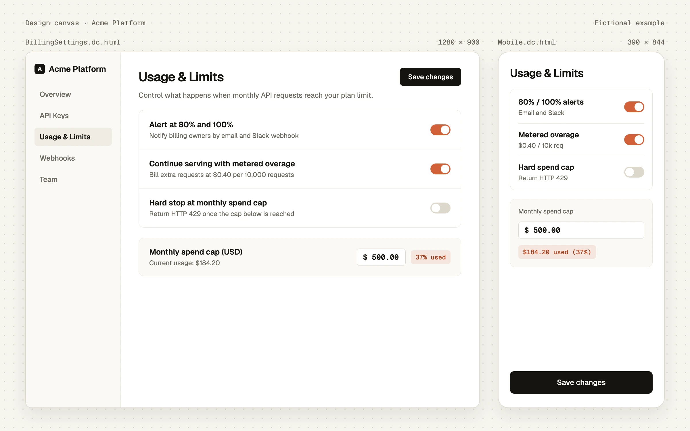
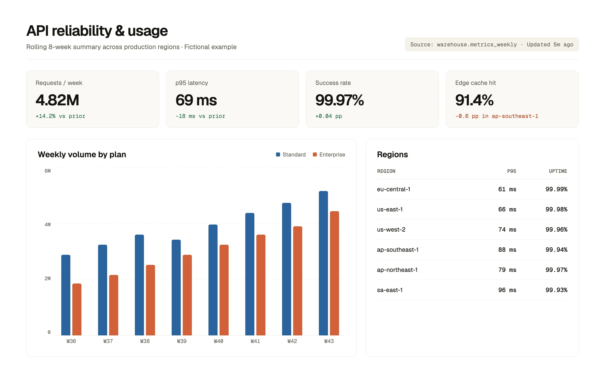

<div align="center">

<picture>
  <source media="(prefers-color-scheme: dark)" srcset="docs/media/hero-dark.webp">
  
</picture>

**Build Design canvases, Slides decks, Design Systems, dashboards, and interactive pages straight from your codebase, check them locally, and keep edits in sync.**<br>
Part of [QualityLayer](https://github.com/maxritter/qualitylayer).

<a href="https://github.com/maxritter/open-claude-artifacts/releases"></a>
<a href="https://github.com/maxritter/open-claude-artifacts/releases"></a>
<a href="https://github.com/maxritter/open-claude-artifacts/stargazers"></a>
<a href="LICENSE.md"></a>

<p>
  <a href="#install">Install</a> ·
  <a href="#examples">Examples</a> ·
  <a href="#agents">Agents</a> ·
  <a href="#reference">Reference</a> ·
  <a href="https://github.com/maxritter/qualitylayer">QualityLayer</a>
</p>

</div>

---

## Why Open Claude Artifacts

| You get | How it works |
| --- | --- |
| **Every Claude Artifact type** | Create and edit Design canvases, Slides decks, Design Systems, Data dashboards, Whiteboards, Docs, Sheets, and plain pages from one CLI. |
| **Local preview checks** | Renders artboards, slides, and pages locally in Chrome before pushing, reporting console errors and missing assets. |
| **Always matches Claude's current format** | Pulls Anthropic's current artifact guide and your default Design System straight from the artifact. |
| **Conflict-safe two-way sync** | Checks for remote changes before saving so neither code nor design silently overwrites the other. |
| **Comments, assets, and data** | Upload images and fonts, answer comment threads sent to Claude, query shared databases, and manage sharing or versions. |

---

<h2 id="install">Getting started</h2>

**Prerequisites:** macOS, Linux, or WSL2 and a Claude account with artifact access (Pro, Max, Team, or Enterprise). No Claude Code installation or Anthropic API key is required.

```bash
curl -fsSL https://github.com/maxritter/open-claude-artifacts/releases/latest/download/install.sh | sh
```

The installer installs `open-claude-artifacts`, adds five portable skills to detected agents, and opens a one-time browser login. Existing `open-claude-design` artifact logins continue to work automatically. Over SSH or in containers, run `open-claude-artifacts login --manual`.

1. Ask your coding agent in plain words:

```text
Design this settings page in Claude Artifacts using our real components.
```

2. Your agent renders the result locally to check layout, then publishes it.
3. Open the returned `claude.ai` link to review, comment, or edit directly.

<details>
<summary><b>Uninstalling</b></summary>

```bash
curl -fsSL https://github.com/maxritter/open-claude-artifacts/releases/latest/download/uninstall.sh | sh
```

</details>

---

<h2 id="examples">What you can make</h2>

Fictional examples showing what your agent can build, check locally, and revise.

<table>
<tr>
<td width="50%" valign="top">

<p><strong>Slides decks</strong><br>
<em>"Turn our Q3 latency writeup into a 12-slide deck and check every slide locally."</em></p>
</td>
<td width="50%" valign="top">
<picture>
  <source media="(prefers-color-scheme: dark)" srcset="docs/media/examples/app-dark.webp">
  
</picture>
<p><strong>Design canvases</strong><br>
<em>"Design the Usage and Limits screen for desktop and mobile with our components."</em></p>
</td>
</tr>
<tr>
<td width="50%" valign="top">
<picture>
  <source media="(prefers-color-scheme: dark)" srcset="docs/media/examples/dashboard-dark.webp">
  
</picture>
<p><strong>Data dashboards and pages</strong><br>
<em>"Build an API reliability dashboard artifact backed by its shared database."</em></p>
</td>
<td width="50%" valign="top">
<picture>
  <source media="(prefers-color-scheme: dark)" srcset="docs/media/examples/design-system-dark.webp">
  
</picture>
<p><strong>Design systems</strong><br>
<em>"Extract our CSS tokens and component states into a Design System artifact."</em></p>
</td>
</tr>
</table>

---

<h2 id="agents">Works with your agent</h2>

One installer adds the same five skills across 70+ coding agents, including **Claude Code**, **Codex**, **OpenCode**, **Cursor**, **GitHub Copilot**, **Gemini CLI**, **Cline**, **Antigravity**, **Kimi**, **Kiro**, **Pi**, **Trae**, **Qoder**, **Rovo Dev**, **Mistral Vibe**, **Hermes**, **Grok Build**, **OpenClaw**, **Warp**, **Zed**, and **Amp**. (`eve` and `promptscript` install at project scope only.)

### Skills your agent gets

| Skill | For | You say |
| --- | --- | --- |
| `open-claude-artifacts` | Creating, editing, rendering, and syncing Claude Artifacts | "Update slide 16 in this deck and verify it locally." |
| `open-claude-ui-design` | Designing new screens, flows, and interactive prototypes | "Design a billing limits screen in our existing style." |
| `open-claude-design-system` | Extracting and packaging tokens and component contracts | "Extract our tokens and button states into a Design System." |
| `open-claude-ui-review` | Visual, accessibility, and interaction review of UI | "Audit this page for contrast, spacing, and mobile issues." |
| `open-claude-design-quality` | Shared craft and visual quality rules for UI changes | Applied automatically during user-visible UI edits |

---

## Design in QualityLayer

Need a local-first design workspace without a Claude subscription? [QualityLayer](https://github.com/maxritter/qualitylayer) runs mockups, diagrams, clickable pages, planning, implementation, and independent review right inside its desktop App using your own coding agent. **[Try QualityLayer](https://github.com/maxritter/qualitylayer)**.

---

<h2 id="reference">Reference</h2>

<details>
<summary><b>CLI commands</b></summary>

```bash
# Auth and setup
open-claude-artifacts login [--manual] [--timeout 300]
open-claude-artifacts logout --yes
open-claude-artifacts status --json
open-claude-artifacts doctor [--offline] --json
open-claude-artifacts install|update|uninstall [--scope global|project] [--yes]
open-claude-artifacts skills --json

# Discovery and live guides
open-claude-artifacts list [--scope mine|shared|all] --json
open-claude-artifacts types --json
open-claude-artifacts type 'Slides' --json
open-claude-artifacts instances 'Design System' --json
open-claude-artifacts inspect '<artifact>' [--version <ver>] --json
open-claude-artifacts files '<artifact>' [--version <ver>] [--all] --json
open-claude-artifacts preview '<artifact>' [--open] --json
open-claude-artifacts authoring-context '<artifact>' [--design-system <id>|none] --json
open-claude-artifacts contract [--version latest] [--capability db] --json

# Create, edit, and render locally
open-claude-artifacts create 'Deck title' --type Slides --idempotency-key <uuid> --allow-write --json
open-claude-artifacts pull '<artifact>' project/deck.json --output deck.json --json
open-claude-artifacts push '<artifact>' --file 'project/deck.css=deck.css' --if-match 'project/deck.css=<sha>' --allow-write --json
open-claude-artifacts publish 'Report' --page index.html [--capabilities '{"db":{}}'] --allow-write --json
open-claude-artifacts render '<canvas-or-page>' [--path project/Main.dc.html] [--local 'project/Main.dc.html=<draft>'] --json
open-claude-artifacts render '<deck>' [--slide 1 --slide cover] [--local 'project/deck.css=deck.css'] --json
open-claude-artifacts design-system install '<canvas-or-deck>' '<system>' --allow-write --json

# Assets, comments, shared database, sharing, versions, and code sync
open-claude-artifacts assets list|upload|pull|copy|delete '<artifact>' ...
open-claude-artifacts comments list|reply|resolve '<artifact>' ...
open-claude-artifacts db get|list|query|set|update|str-replace|delete|batch|whoami '<artifact>' ...
open-claude-artifacts share '<artifact>' [--mode private|org|people|public] ...
open-claude-artifacts versions|retitle|pin|unpin|delete|diagnostics|profiles '<artifact>' ...
open-claude-artifacts sync review|apply|finish|status ...
```

</details>

<details>
<summary><b>Supported artifact types</b></summary>

| Type | Content model | Local headless render |
| --- | --- | --- |
| `Design` | `project/canvas.json` (v3) + `.dc.html` artboards | Yes (light and dark, custom widths) |
| `Slides` | `project/deck.json` (v4/v5) + `project/deck.css` + `project/slides/*.html` | Yes (16:9 and 4:3, by slide or full deck) |
| `Design System` | `project/design-system.json` (v3) + `project/tokens.json` + component previews | Open in Claude |
| `Data` (`Dashboard`) | Shared artifact database (`db`) | Open in Claude |
| `Whiteboard` | Shared artifact database (`db`) | Open in Claude |
| `Docs` / `Sheets` | Created and read here; body managed via Claude Docs | Open in Claude |
| Plain artifact page | `index.html` + files + optional runtime capabilities | Yes (light and dark, custom widths) |
| Migrated Design | Read-only inspection, file pull, and authoring context | Open in Claude |

</details>

<details>
<summary><b>Security and local files</b></summary>

- OAuth credentials stay in macOS Keychain or a `0600` file under `~/.config/open-claude-artifacts/`.
- Every remote write requires `--allow-write`; file pushes pin `--if-match` SHA-256 hashes with byte-for-byte readback; database writes to existing documents pin `--if-version`; deletions require `--allow-destructive`; public sharing requires `--allow-public`.
- Local renders run in an isolated headless Chromium profile restricted to loopback and the artifact CDN allowlist.
- Scratch context, render PNGs, and sync receipts stay under `.open-claude-artifacts/` and are excluded via `.git/info/exclude`.

See [SECURITY.md](SECURITY.md) and [CONTRIBUTING.md](CONTRIBUTING.md).

</details>

---

<div align="center">

Made by [Max Ritter](https://maxritter.net) · [License](LICENSE.md) · Independent project, not affiliated with Anthropic.

</div>
