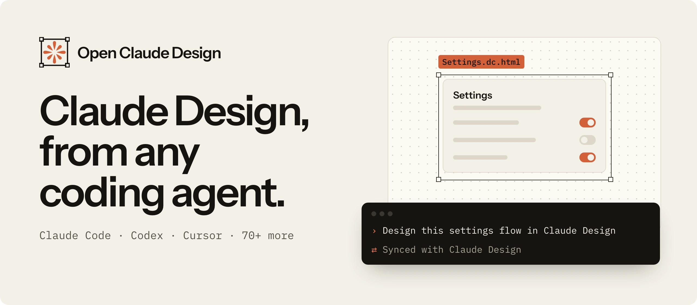
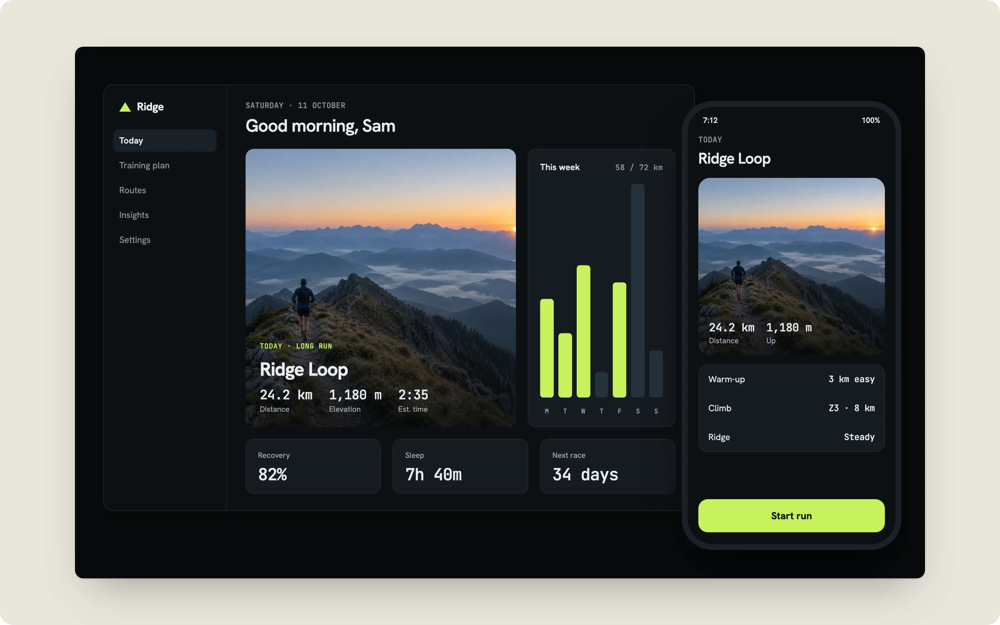
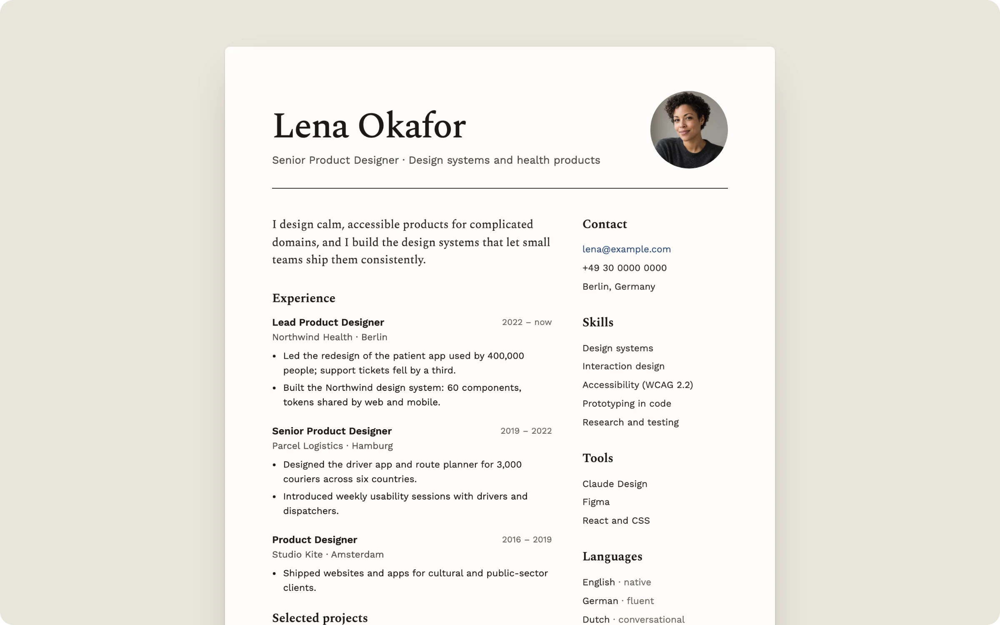
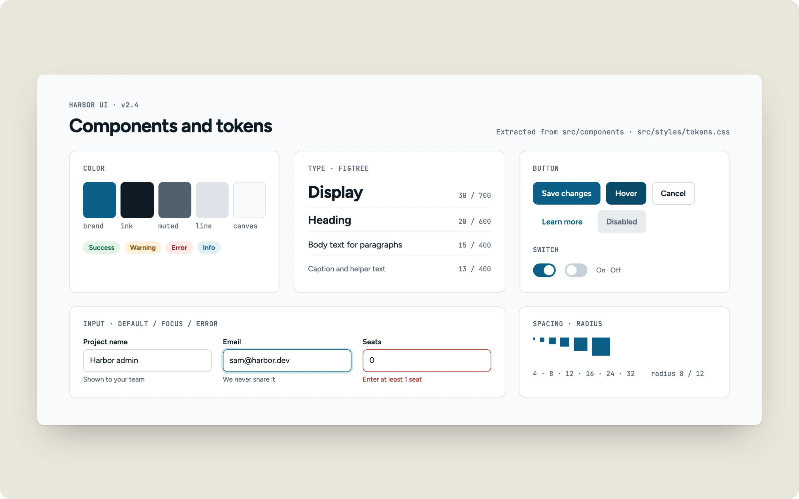

<div align="center">

<picture>
  <source media="(prefers-color-scheme: dark)" srcset="docs/media/hero-dark.webp">
  
</picture>

**Open Claude Design is now part of [QualityLayer](https://github.com/maxritter/qualitylayer).**

Create and review designs with your coding agent in QualityLayer, even without a Claude subscription.<br>
The free, source-available Open Claude Design CLI remains available on its own.

**[Try QualityLayer](https://github.com/maxritter/qualitylayer)** · [Install Open Claude Design](#quick-start)

[](https://github.com/maxritter/open-claude-design/stargazers)
[](https://github.com/maxritter/open-claude-design/releases)
[](https://github.com/maxritter/open-claude-design/releases)
[](LICENSE.md)

<a href="#design-in-qualitylayer">QualityLayer</a> ·
<a href="#quick-start">Standalone setup</a> ·
<a href="#what-you-can-make">Examples</a> ·
<a href="#works-with-every-coding-agent">Agents</a> ·
<a href="#reference">Reference</a>

</div>

## Design in QualityLayer

[QualityLayer](https://github.com/maxritter/qualitylayer) brings design into the same workspace as your coding agent. Create mockups, diagrams, and clickable pages from your codebase, leave comments, and ask your agent to revise them. You can work on a design on its own or use it to plan a code change.

**QualityLayer's own design workspace works without a Claude subscription.** Use Codex or another supported coding agent with its own account or API key. Your chosen agent's model usage is separate from QualityLayer.

For the full development workflow, QualityLayer adds plan approval before code changes, implementation in tested steps, independent AI review, and team collaboration. [Explore QualityLayer on GitHub](https://github.com/maxritter/qualitylayer) or read the [artifact guide](https://qualitylayer.dev/docs/artifacts).

> [!NOTE]
> Connecting to **Anthropic's Claude Design** through Open Claude Design still requires a Claude account with access. QualityLayer's own artifacts work independently of that connection.

## Quick start

### Use Open Claude Design on its own

Open Claude Design connects your coding agent to Anthropic's visual design workspace. Create Claude Design files from your real components, tokens, and copy, refine them on the canvas, and sync changes back into code. It works with Claude Code, Codex, Cursor, Gemini CLI, and 70+ other coding agents.

```bash
curl -fsSL https://github.com/maxritter/open-claude-design/releases/latest/download/install.sh | sh
```

**macOS · Linux · WSL2** · No Claude Code installation or Anthropic API key required

**You need** macOS, Linux, or WSL2 and a Claude account with access to the workspace you want to use. The new artifact connection was tested with Claude Max. Anthropic documents native artifact publishing for Pro, Max, Team, and Enterprise; Free access through this CLI is unverified.

> [!IMPORTANT]
> **v1.8 covers everything Claude Code's own artifact tools can do, from any coding agent.** Make Design canvases, Slides decks, Design System artifacts, and artifact pages; upload assets; answer comments; read and write an artifact's database; share, version, and delete; and render designs locally in light and dark at desktop and phone widths. Connect it separately with `open-claude-design login --backend artifact`. Existing standalone workflows remain available until Anthropic's announced **December 14, 2026** closure. See the [artifact workflow](skills/open-claude-design/references/artifacts.md) and [migration guide](https://support.claude.com/en/articles/17440474-migrate-from-standalone-claude-design-to-claude).

1. **Run the installer above.** It installs the CLI and adds the workflows to every coding agent it finds. Its existing standalone browser connection remains available; the artifact backend has its own login.

2. **Ask your coding agent for a design, deck, or design system and mention Claude Design.** No special agent command is needed. The agent creates an artifact, loads Anthropic's current guide for that kind of artifact and your default design system, and opens the one-time browser connection if needed.

   > Create a Claude Design version of this settings flow, using the real components and states from the codebase.

3. **Open the result in Claude Design.** Follow the artifact link your agent returns. Change what you like on the canvas, then ask your agent to bring the changes into the code. An existing standalone project link keeps using the standalone connection.

## What you can make

Fictional examples, each built by a coding agent with Open Claude Design and opened in Claude Design.

<table>
<tr>
<td width="50%" valign="top">

<p><strong>Slides and pitch decks</strong><br>
<em>“Turn the product summary in our README into a seed deck in Claude Design.”</em></p>
</td>
<td width="50%" valign="top">

<p><strong>Apps for desktop and mobile</strong><br>
<em>“Design the training dashboard and its phone screen in Claude Design with our components.”</em></p>
</td>
</tr>
<tr>
<td width="50%" valign="top">

<p><strong>CVs and documents</strong><br>
<em>“Lay out my CV as a one-page A4 document in Claude Design.”</em></p>
</td>
<td width="50%" valign="top">

<p><strong>Design systems from your code</strong><br>
<em>“Extract our tokens and components into a Claude Design design system.”</em></p>
</td>
</tr>
</table>

## How it works

1. **Create from code.** Your agent reads the real components, tokens, assets, copy, and states, and writes a Claude Design file from them.
2. **Refine on the canvas.** Open the file in Claude Design, compare options, comment, and edit it directly.
3. **Sync both ways.** Your agent brings approved changes into the code, or pushes code changes to the design. If both sides changed, it shows you the conflict instead of picking a winner.

## What it can do

- **Work with every kind of Claude artifact.** Design canvases, Slides decks, Design System artifacts, and plain artifact pages with runtime capabilities. Install a design system into a canvas or deck with one command. Experimental; no operation makes a model call.
- **Handle what surrounds the design.** Upload and copy assets, answer comment threads sent to Claude, read and write an artifact's shared database, share privately or publicly, list versions, rename, pin, and delete.
- **Use your standalone Claude Design workspace.** Projects, files, previews, design systems, conversations, comments, members, and sharing.
- **Manage design systems from your agent.** Create, publish, and unpublish them, manage their preview cards, and set your organization's default.
- **Move real files.** Upload and download images, fonts, and other files up to 16 MiB, and export a whole project as a ZIP.
- **Prepare for migration.** Check standalone inventories and preserve chats, comments, and project metadata with `export --include-history`.
- **Verify design files.** The CLI checks structure and linked resources and reads written bytes back. Standalone previews render through the service. Artifact artboards and pages render locally in headless Chrome, published or still in draft, with console errors reported.
- **Keep pages findable.** Standalone pages stay at the project root. Artifact artboards live under `project/` and appear in the canvas index.
- **Stay light on context.** Claude Design's current guidance loads only when a task needs it.

## Works with every coding agent

Every supported agent gets the same workflows and CLI access through one installer.

| Coding agents | Status |
|---|:---:|
| Claude Code · Codex · OpenCode | ✅ Full |
| Cursor · GitHub Copilot · Cline · Trae · Qoder · Rovo Dev | ✅ Full |
| Gemini CLI · Antigravity · Kimi · Kiro · Pi | ✅ Full |
| Mistral Vibe · Hermes · Reasonix · Grok Build · OpenClaw | ✅ Full |
| Warp · Zed · Amp · other Agent Skills hosts | ✅ Full |

The installer finds installed agents through pinned `skills@1.7.0`. Explicit installs support all 79 agent identifiers, and `--all-agents` checks every integration for the chosen scope. Eve and PromptScript support project scope only.

## Works with Impeccable

[Impeccable](https://github.com/pbakaus/impeccable) adds design refinement commands, automated design checks, and edit-time hooks. It is optional.

## Reference

<details>
<summary><strong>Claude Design operations the CLI covers (23)</strong></summary>

An authenticated check on October 5, 2026 found these 23 operations in Claude Design's live tool catalog. The CLI discovers the catalog at runtime. This is tool coverage, not a claim that every feature of the Claude web app has an API.

| Area | Operations |
|---|---|
| **Projects and files** (8) | List projects · inspect a project · create a project · list files · read a file · write files · copy files · delete files |
| **Design guidance and previews** (6) | List design systems · load the project prompt · load a design skill · render a preview · create support JavaScript · finalize an authoring plan |
| **Conversations and comments** (4) | Read a conversation · update a conversation · list comments · acknowledge comments |
| **Members and sharing** (5) | List members · add a member · remove a member · change a member role · update sharing |

This catalog belongs to standalone Claude Design. Claude artifacts use a separate experimental backend described below. Organization-wide artifact migration and native PDF, PPTX, and Google Slides exports are outside this CLI release's verified scope. ZIP export can preserve files, chats, comments, and project metadata. Open Claude Design does not imitate missing interfaces with browser control.

</details>

<details>
<summary><strong>Claude artifacts (experimental)</strong></summary>

| Area | Commands |
|---|---|
| **Find** | `list` (mine, shared, all) · `types` · `type` · `instances` · `inspect` · `files` · `versions` |
| **Create and author** | `create --type Design\|Slides\|'Design System'\|Dashboard\|Docs` · `authoring-context` · `contract` · `push` · `publish` (plain pages) · `pull` · `design-system install` |
| **Verify** | `render` (local, light and dark, any width) · `preview` · `diagnostics` |
| **Sync with code** | `sync review` · `sync apply` · `sync finish` · `sync status` |
| **Assets** | `assets upload` · `list` · `pull` · `copy` · `delete` |
| **Comments** | `comments list` · `reply` · `resolve` |
| **Database** | `db get` · `list` · `query` · `set` · `update` · `str-replace` · `delete` · `batch` · `whoami` |
| **Share and manage** | `share` · `retitle` · `pin` · `unpin` · `delete` · `profiles` |

```bash
open-claude-design login --backend artifact
open-claude-design artifacts create 'Settings flow' --type Design \
  --idempotency-key '<retained-uuid>' --allow-write --json
open-claude-design artifacts authoring-context '<artifact>' --json
open-claude-design artifacts render '<artifact>' --local 'project/Main.dc.html=draft.dc.html' --json
open-claude-design artifacts push '<artifact>' \
  --file 'project/canvas.json=<local-index>' --if-match 'project/canvas.json=0' \
  --file 'project/Main.dc.html=<local-source>' --if-match 'project/Main.dc.html=0' \
  --allow-write --open --json
open-claude-design artifacts sync review '<artifact>' \
  --direction to-code --pair 'project/Main.dc.html=src/settings.tsx' --json
```

The backend talks directly to the frame service that Claude Code's own Artifact tool uses (protocol of Claude Code 2.1.304, runtime contract 0.2.87). It requires no Claude Code installation, API key, or model call. Its subscription authorization screen identifies the native client as **Claude Code**, but Open Claude Design stores its own login and leaves your Claude Code configuration intact. The protocol is observed, not a documented public SDK, so compatibility may change upstream.

`authoring-context` saves Anthropic's current guide for the artifact's type, a map from the guide's tool calls to these commands, and your default design system's README and tokens. Every write pins the artifact version and each file's SHA-256 (`0` only for confirmed absence) and reads the exact published version back. Public writes, public sharing, removals, and deletes each need their own explicit flag. `render` serves a local copy through a loopback server with the type's runtime and the artifact's assets, limits the network to the artifact CDN allowlist, and reports console errors.

Live testing on a Max account on October 20, 2026 covered every command group except comment replies, which need a thread someone sent to Claude. Slides and Design System artifacts have no local renderer; check them in Claude. Dashboards keep their content in the artifact database and Docs in the Claude Docs connector. See the [artifact workflow](skills/open-claude-design/references/artifacts.md) and [artifact collaboration](skills/open-claude-design/references/artifact-collaboration.md) for guards, limits, and recovery.

</details>

<details>
<summary><strong>Prepare for the move to Claude Artifacts</strong></summary>

```bash
open-claude-design migration status --json
open-claude-design migration resolve 'https://claude.ai/code/artifact/<id>' --json
open-claude-design migration check <standalone-project-id> --json
open-claude-design export <standalone-project-id> \
  --include-history \
  --output .open-claude-design/archives/project.zip --json
```

The first two commands run offline. The readiness check reads a single standalone inventory and reports archive limits; Anthropic's own checker determines migration eligibility. History export preserves files, chats, comments, and project metadata, with credentials and preview capabilities redacted. It saves nothing if history is incomplete or changes during export. Chats and comments are not carried over by Anthropic's migration, so preserve anything you need before closure.

Migration affects all design systems in an organization, and published non-private systems become organization-wide on team plans. Originals and migrated copies remain separate. Project-migration details are still pending. The CLI never starts migration or changes visibility as part of a check.

`status --backend artifact` now verifies the separate artifact login, and `capabilities --backend artifact` reports its supported workflows. Standalone project commands reject artifact URLs; use the `artifacts` command group for the new canvas. See the [migration workflow](skills/open-claude-design/references/migration.md) for permission, preservation, and verification details.

</details>

<details>
<summary><strong>CLI commands</strong></summary>

| Standalone capability | Command |
|---|---|
| Complete project and design-system inventory | `projects`, `design-systems list` |
| Design-system creation and publication | `design-systems create`, `publish`, `unpublish` |
| Preview cards and compiled manifests | `design-systems cards`, `register`, `unregister`, `inspect` |
| Organization defaults | `design-systems settings`, `default --if-current …` |
| Project lifecycle and design-system bindings | `project rename`, `project inspect`, `project bind`, `project delete` |
| Pages the editor will not list | `project pages` |
| A live window that refreshes on every write | `project live` |
| Original files and project ZIPs | `pull`, `push`, `export` |
| Checks without a browser and batched reads | `validate`, `preview`, `batch` |
| Current feature boundaries | `capabilities --json` |

</details>

<details>
<summary><strong>The five Agent Skills</strong></summary>

Your agent loads these automatically when a request needs them.

| Skill | What it handles |
|---|---|
| `open-claude-design` | Claude Design access, collaboration, and two-way sync |
| `open-claude-ui-design` | Product UI creation and redesign in the real codebase |
| `open-claude-design-system` | Design-token and component-system extraction or normalization |
| `open-claude-ui-review` | Accessibility, brand, responsive, theme, state, and UX review |
| `open-claude-design-quality` | Product-grounded visual quality for every user-visible change |

</details>

<details>
<summary><strong>How remote changes stay safe</strong></summary>

Access is read-only by default, and changes need your explicit request. File writes, copies, deletes, previews, and authoring plans run only through guarded `push`, `delete`, `planned-call`, and `preview` helpers. Writes target exact paths and check for concurrent changes. Deletes keep a backup. The CLI reads changes back and confirms the preview loads.

Standalone pages must sit at the project root. A page in a folder still opens by direct link but never appears in Claude Design's Pages menu, so `push`, `planned-call`, and `sync` refuse it unless you pass `--allow-nested-page`. `push` also refuses a design file the Claude Design editor could not edit: an expression inside `{{ }}`, a capitalized component tag, or an element left without its closing tag. Running JavaScript, layout, and interaction remain a separate visual review (`render_executed: false`).

The same login serves both Claude Design APIs. Metadata changes can use a temporary project grant that you acknowledge; new grants are revoked and checked afterwards, and existing grants are kept.

</details>

## Maintenance

| What do you want to do? | Command |
|---|---|
| **Connect the artifact backend** | `open-claude-design login --backend artifact` |
| **Check the artifact connection** | `open-claude-design status --backend artifact --json` |
| **Disconnect the artifact backend** | `open-claude-design logout --backend artifact` |
| **Reconnect your standalone account** | `open-claude-design login` |
| **Disconnect your Claude account** | `open-claude-design logout` |
| **Check the connection** | `open-claude-design status --json` |
| **Check installed agents** | `open-claude-design doctor --json` |
| **Check every supported agent** | `open-claude-design doctor --all-agents --json` |
| **List the included skills** | `open-claude-design list` |
| **Update or repair Open Claude Design** | `curl -fsSL https://github.com/maxritter/open-claude-design/releases/latest/download/install.sh \| sh` |
| **Upgrade an uv-managed CLI and its skills** | `uv tool upgrade open-claude-design && open-claude-design update --scope global --yes` |
| **Uninstall Open Claude Design** | `curl -fsSL https://github.com/maxritter/open-claude-design/releases/latest/download/uninstall.sh \| sh` |

If an older installation reports a deleted temporary wheel path during `uv tool upgrade`, run the installer once to repair it.

<details>
<summary><strong>A "claude-design" connector in your agent fails with HTTP 403</strong></summary>

That connector signs in with your agent's own account token, which has no Claude Design access. Claude Design is not down and your account is fine; the entry simply cannot sign in, and it skips the safety checks this CLI enforces. `open-claude-design doctor --json` names the configuration file and entry under `native_connectors`. In Claude Code, remove it with `claude mcp remove <server>`. Open Claude Design never registers an MCP server; the CLI is its only connection.

A 403 from `open-claude-design status` itself is different: the login worked but access was refused, so the account needs Claude Design enabled. Enterprise organizations enable it centrally. Logging in again with the same account will not change it.

</details>

## Open for pull requests

Use the forms to [report a bug](https://github.com/maxritter/open-claude-design/issues/new?template=bug_report.yml) or [request a feature](https://github.com/maxritter/open-claude-design/issues/new?template=feature_request.yml). Read [CONTRIBUTING.md](CONTRIBUTING.md) before opening a pull request.

## License

Open Claude Design is free and source-available. Personal and internal commercial use are allowed; redistribution, rebranding, competing publication, and hosted resale are restricted. See [LICENSE.md](LICENSE.md).

Open Claude Design is part of QualityLayer. It is not affiliated with, sponsored by, or endorsed by Anthropic, and its spark mark is its own.

<div align="center">

<picture>
  <source media="(prefers-color-scheme: dark)" srcset="docs/media/brand/mark-small-dark.svg">
  
</picture>

Made by [Max Ritter](https://maxritter.net)

</div>
