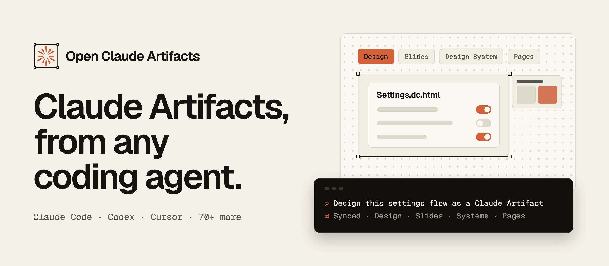
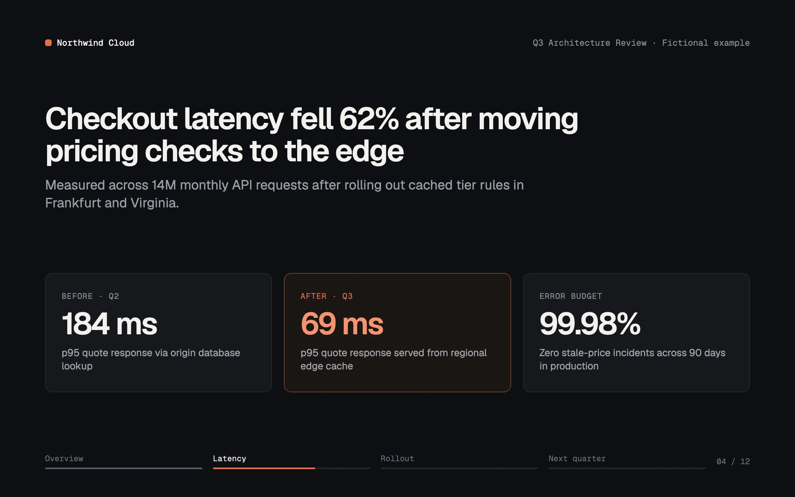
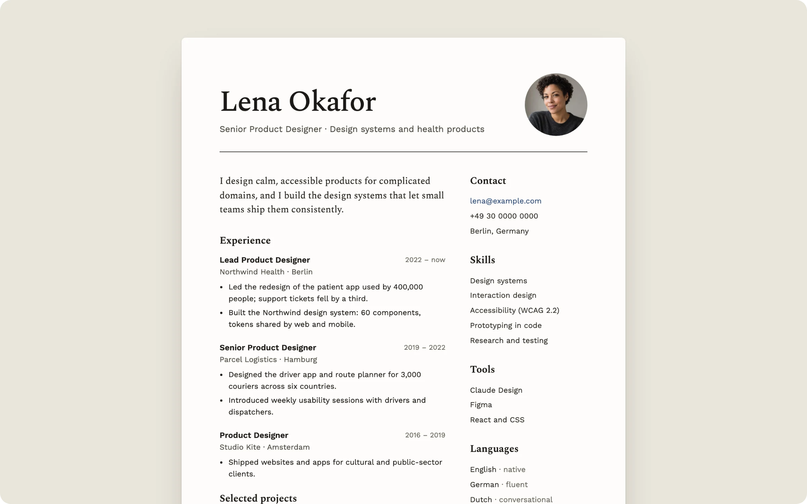
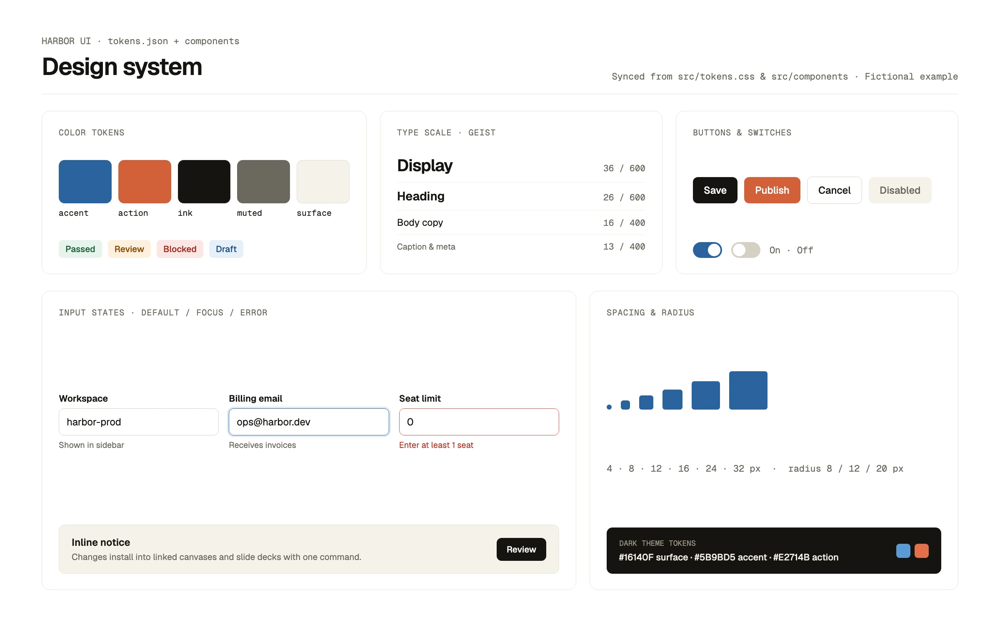

<div align="center">

<picture>
  <source media="(prefers-color-scheme: dark)" srcset="docs/media/hero-dark.webp">
  
</picture>

**Open Claude Artifacts is part of [QualityLayer](https://github.com/maxritter/qualitylayer).**

Create, render, and sync Claude Artifacts from any coding agent — Claude Code, Codex, Cursor, Gemini CLI, OpenCode, and 70+ more.<br>
For a full local-first design workspace that works without a Claude subscription, use [QualityLayer](https://github.com/maxritter/qualitylayer).

**[Try QualityLayer](https://github.com/maxritter/qualitylayer)** · [Install Open Claude Artifacts](#quick-start)

[](https://github.com/maxritter/open-claude-artifacts/stargazers)
[](https://github.com/maxritter/open-claude-artifacts/releases)
[](https://github.com/maxritter/open-claude-artifacts/releases)
[](LICENSE.md)

<a href="#quick-start">Install</a> ·
<a href="#what-you-can-make">What you can make</a> ·
<a href="#what-it-can-do">Capabilities</a> ·
<a href="#works-with-every-coding-agent">Agents</a> ·
<a href="#cli-reference">CLI reference</a>

</div>

## Quick start

Open Claude Artifacts (formerly *Open Claude Design*) connects any coding agent directly to Anthropic's native **Claude Artifacts** platform — **Design** canvases, **Slides** decks, **Design Systems**, **Data** dashboards, **Whiteboards**, **Docs**, **Sheets**, and plain interactive artifact pages — with local headless Chromium rendering and verified two-way code sync.

```bash
curl -fsSL https://github.com/maxritter/open-claude-artifacts/releases/latest/download/install.sh | sh
```

**macOS · Linux · WSL2** · No Claude Code installation or Anthropic API key required.

**You need** macOS, Linux, or WSL2 and a Claude account with artifact access (Pro, Max, Team, or Enterprise). Existing `open-claude-design` artifact logins are detected automatically.

1. **Run the installer above.** It installs `open-claude-artifacts` and adds its five portable Agent Skills to every coding agent it finds.
2. **Connect once** with `open-claude-artifacts login` (or `open-claude-artifacts login --manual` in SSH/CI/containers).
3. **Ask your coding agent** for a Design canvas, Slides deck, Design System, or artifact page:
   > Create a Claude Design canvas for this settings flow using our real components, render it locally to verify, and sync approved edits back into code.

## What you can make

<table>
<tr>
<td width="50%" valign="top">

<p><strong>Slides and pitch decks</strong><br>
<em>“Turn our product summary into a 16:9 Claude Slides deck and render every slide locally to check layout.”</em></p>
</td>
<td width="50%" valign="top">

<p><strong>Apps for desktop and mobile</strong><br>
<em>“Design the training dashboard and its phone screen as a Claude Design canvas with our components.”</em></p>
</td>
</tr>
<tr>
<td width="50%" valign="top">

<p><strong>Pages and interactive artifacts</strong><br>
<em>“Publish an interactive report page with its own shared database and check it in headless Chrome.”</em></p>
</td>
<td width="50%" valign="top">

<p><strong>Design systems from your code</strong><br>
<em>“Extract our tokens and components into a Claude Design System artifact and install it into our deck.”</em></p>
</td>
</tr>
</table>

## What it can do

- **Every Claude Artifact type in one CLI.** `Design`, `Slides` (v4 & v5 decks), `Design System`, `Data` dashboards, `Whiteboard`, `Docs`, `Sheets`, Migrated Designs, and plain untyped artifact pages.
- **Headless local rendering — no browser hijacking.** `open-claude-artifacts render` renders **Design artboards**, **Slides decks** (`--slide <id|number>`, 16:9 & 4:3, with `/_blob/` SVG/PNG/WebP MIME sniffing), and **plain pages** locally in headless Chrome, Chromium, Edge, or Playwright Chromium — published or in draft via `--local` before pushing.
- **Live host guidance on demand.** `authoring-context` fetches Anthropic's current `SKILL.md`, reference docs, and default Design System tokens straight from the artifact type so your agent never uses stale format rules.
- **Full collaboration plane.** Upload, list, pull, copy, and delete `/_blob/<id>` assets; read, reply to, and resolve comment threads; read and write the shared artifact database (`db`); manage sharing, versions, pinning, renaming, profiles, diagnostics, and deletion.
- **Guarded, conflict-aware writes.** Every mutation requires `--allow-write` (and `--allow-destructive` for deletes, `--allow-public` for public sharing), pins exact SHA-256 hashes (`--if-match`), and verifies readback byte-for-byte.
- **Two-way code sync.** `sync review`, `sync apply`, and `sync finish` track revision receipts and detect `both-changed` conflicts instead of silently overwriting either side.

## Design in QualityLayer

[QualityLayer](https://github.com/maxritter/qualitylayer) includes its own local-first artifact and design workspace inside the App — working without a Claude subscription using Claude Code, Codex, Cursor, or any supported coding agent, alongside Plan, Implement, and Verify workflows. [Explore QualityLayer on GitHub](https://github.com/maxritter/qualitylayer).

## Works with every coding agent

Every supported agent gets the same five portable skills and CLI access through one installer (`skills@1.7.0`, supporting 79 agent identifiers):

| Coding agents | Status |
|---|:---:|
| Claude Code · Codex · OpenCode | ✅ Full |
| Cursor · GitHub Copilot · Cline · Trae · Qoder · Rovo Dev | ✅ Full |
| Gemini CLI · Antigravity · Kimi · Kiro · Pi | ✅ Full |
| Mistral Vibe · Hermes · Reasonix · Grok Build · OpenClaw | ✅ Full |
| Warp · Zed · Amp · other Agent Skills hosts | ✅ Full |

## CLI reference

```bash
# Auth & setup
open-claude-artifacts login [--manual] [--timeout 300]
open-claude-artifacts status --json
open-claude-artifacts doctor [--offline] --json
open-claude-artifacts install|update|uninstall [--scope global|project] [--yes]
open-claude-artifacts skills --json

# Discovery & live guidance
open-claude-artifacts list [--scope mine|shared|all] --json
open-claude-artifacts types --json
open-claude-artifacts type 'Slides' --json
open-claude-artifacts instances 'Design System' --json
open-claude-artifacts inspect '<artifact>' [--version <ver>] --json
open-claude-artifacts files '<artifact>' [--all] --json
open-claude-artifacts authoring-context '<artifact>' [--design-system <id>|none] --json
open-claude-artifacts contract [--version latest] [--capability db] --json

# Author, publish, and render locally
open-claude-artifacts create 'Deck title' --type Slides --idempotency-key <uuid> --allow-write --json
open-claude-artifacts pull '<artifact>' project/deck.json --output deck.json --json
open-claude-artifacts push '<artifact>' --file 'project/deck.css=deck.css' --if-match 'project/deck.css=<sha>' --allow-write --json
open-claude-artifacts publish 'Report' --page index.html [--capabilities '{"db":{}}'] --allow-write --json
open-claude-artifacts render '<artifact>' [--slide 1 --slide cover] [--path project/Main.dc.html] [--local 'project/deck.css=deck.css'] --json
open-claude-artifacts design-system install '<canvas-or-deck>' '<system>' --allow-write --json

# Assets, comments, database, sharing, versions, and code sync
open-claude-artifacts assets list|upload|pull|copy|delete '<artifact>' ...
open-claude-artifacts comments list|reply|resolve '<artifact>' ...
open-claude-artifacts db get|list|query|set|update|str-replace|delete|batch|whoami '<artifact>' ...
open-claude-artifacts share '<artifact>' [--mode private|org|people|public] ...
open-claude-artifacts versions|retitle|pin|unpin|delete|diagnostics|profiles '<artifact>' ...
open-claude-artifacts sync review|apply|finish|status ...
```

## License

Source-available — see [LICENSE.md](LICENSE.md). Independent project, not affiliated with Anthropic.
